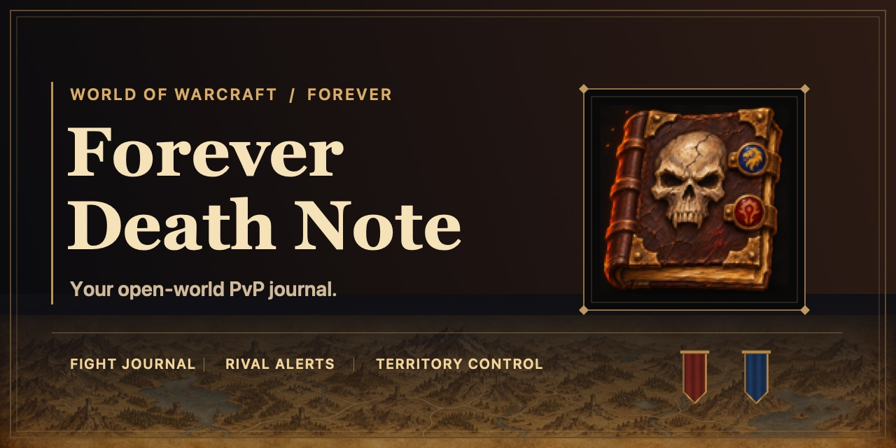

# Forever Death Note

**An open-world PvP journal for WoW Forever.** Record your fights, keep track of rivals, and see which factions and guilds lead in each zone.

[Installation](#installation) · [CurseForge](https://www.curseforge.com/wow/addons/forever-death-note-pvp) · [Report an issue](https://github.com/Dealwen/ForeverDeathNote/issues/new) · [Документация на русском](README.ru.md)

## What you can do

- **Review your fights.** See who killed whom, when and where it happened, and the killing blow when the game provides it. A short notification confirms your recorded killing blows.
- **Keep tabs on rivals.** Open an opponent’s dossier, compare your head-to-head record, and get an alert when the game detects a tracked rival nearby.
- **Follow the weekly front.** Switch between your own fights and shared reports on the territory map. Select a zone to see the Horde and Alliance scores, the leading guild from the winning faction, and the zone’s top players.
- **See who leads.** Browse player, guild, and class rankings. Earn titles and achievements as you play.
- **Share with guildmates.** Opt in to sync PvP reports and share guild hunts. Shared standings reflect the reports available to the add-on, so coverage varies by realm and guild.

## Installation

**Supported client** · WoW Forever 1.60.1 · Interface 16001

1. Install **Forever Death Note | PVP** from CurseForge. To install from GitHub, use **Code → Download ZIP**, extract it, and rename the extracted folder to `ForeverDeathNote`.
2. For a manual install, put the folder in `World of Warcraft/_forever_/Interface/AddOns/`. Check that `ForeverDeathNote.toc` is directly inside the folder.
3. Enable **Forever Death Note** in the game’s AddOns list. Enter the world and click the book icon under the minimap or type `/fdn`.

The CurseForge package includes the parchment texture for the optional Field Journal theme.

### Quick commands

| Command | Opens |
| --- | --- |
| `/fdn log` | Personal PvP journal |
| `/fdn map` | Territory map |
| `/fdn rank` | Rankings |
| `/fdn settings` | Settings |
| `/fdn lang` | Language picker |
| `/fdn testkill` | Sample kill notification |

Available in English, Russian, German, French, Spanish, Brazilian Portuguese, and Korean.

## Feedback

[Open a GitHub issue](https://github.com/Dealwen/ForeverDeathNote/issues/new) with your add-on version, client language, and steps to reproduce. In-game feedback is available in add-on settings.
